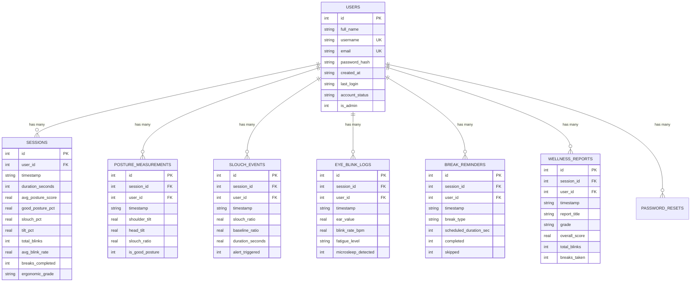

# Digital Wellness Monitor | Sitting Posture & Eye Blink AI

An AI-powered computer vision and ergonomic telemetry system designed to prevent musculoskeletal disorders (text-neck, postural kyphosis, shoulder asymmetry) and Computer Vision Syndrome (eye strain, dry eyes) during prolonged computer use.

> **Major Project Submission**  
> **Technologies:** Python 3.13, FastAPI, OpenCV, MediaPipe (Pose & FaceMesh), Argon2id, ItsDangerous, Web Audio API, Chart.js, HTML5 Canvas, SQLite.

---

## 🔑 Pre-Seeded Demonstration & Administration Accounts

Pre-seeded accounts are provided for project evaluation, academic defense, and system administration:

| Role | Username | Password | Purpose |
|---|---|---|---|
| **Evaluator / Demo** | `demo` | `Demo@123` | Quick evaluation of personalized posture tracking & telemetry (1-click demo button on login page) |
| **Administrator** | `admin` | `Admin@123` | Full user management console, account status toggle, and platform-wide statistics |

---

## 🌟 Key Features

1. **Enterprise-Grade Multi-User Architecture**
   - **Unlimited User Registrations**: Accommodates growing numbers of users, bound only by SQLite/disk storage, with zero arbitrary limits.
   - **Auto-Incrementing User IDs**: Every user is assigned a unique primary key `id` linked as a foreign key across all telemetry tables.
   - **User Details Schema**: User ID, Full Name, Username (Unique), Email (Unique), Argon2id password hash, Registration Date, Last Login, and Account Status (`active` / `suspended`).
   - **Strict Multi-Tenant Isolation**: All monitoring queries enforce `WHERE user_id = ?`, guaranteeing 100% privacy and zero data cross-leakage between accounts.
   - **Performance Indexing**: 10 dedicated SQLite indexes for high-frequency queries on user IDs, usernames, emails, account status, and session timestamps.

2. **Dedicated Relational Wellness Tables**
   - **`sessions`**: Aggregate session telemetry (duration, score, good posture %, slouch %, tilt %, blinks, BPM, breaks, grade).
   - **`posture_measurements`**: Granular periodic records of shoulder tilt, head tilt, slouch ratio, and alignment booleans.
   - **`slouch_events`**: History of slouching incidents, baseline deviations, duration in seconds, and alert triggers.
   - **`eye_blink_logs`**: Eye Aspect Ratio (EAR) logs, rolling blink frequencies (BPM), fatigue ratings, and microsleep alerts.
   - **`break_reminders`**: 20-20-20 breaks, sedentary standing reminders, scheduled duration, and compliance (completed/skipped).
   - **`wellness_reports`**: Formal viva reports, summary grades, total blinks, and evaluator/user notes.

3. **Administrator User Management Console (`/admin/users`)**
   - View all registered users with Full Name, Username, Email, Registration Date, Last Login, and Total Sessions count.
   - Toggle account status (`Active` / `Suspended`) with instant AJAX updates.
   - Platform-wide statistics: Total Registered Users, Active Users, and Total Platform Sessions.
   - **Zero Credential Exposure**: Password hashes are strictly omitted from management queries, APIs, and UI views.

4. **Real-Time Sitting Posture Analysis**
   - **Shoulder Tilt Detection**: Measures lateral shoulder angle $\theta_s$ relative to the horizontal plane.
   - **Head & Cervical Tilt Detection**: Detects lateral neck bending $\theta_h$ to prevent cervical spine strain.
   - **Depth-Invariant Slouch Ratio**: Uses inter-shoulder distance normalization ($R_{slouch} = \Delta y_{\text{head-shoulder}} / W_{\text{shoulder}}$) to detect spinal slouching and forward head posture regardless of camera distance.
   - **Spinal Alignment Vector**: Computes vertical alignment from the head midpoint down to the mid-clavicular/shoulder axis.
   - **One-Click Baseline Calibration**: Allows the user to calibrate their custom upright sitting posture baseline (Press `[C]`).

5. **Ocular Fatigue & Eye Blink Monitoring**
   - **Eye Aspect Ratio (EAR)**: Computes real-time eye aperture using 6 facial landmarks per eye.
   - **Dynamic Blink Counter & BPM**: Tracks blinks per minute (BPM) over a 60-second rolling window.
   - **Dry Eye & CVS Prevention**: Alerts the user when blink frequency drops below the healthy threshold (< 10 BPM).
   - **Microsleep & Drowsiness Alert**: Detects prolonged eye closure (> 2.5 seconds) to prevent exhaustion.

6. **Intelligent Ergonomic Break Alert System**
   - **20-20-20 Rule Timer**: Automatic 20-minute countdown with sound alerts and a guided 20-second visual breathing circle ("Look at an object 20 feet away for 20 seconds").
   - **Prolonged Sitting Alert**: Configurable sedentary timer (30–60 mins) prompting the user to stand up, hydrate, and stretch.
   - **Slouch Duration Alert**: Triggers visual warning banners and speech prompts if bad posture persists for > 4 continuous seconds.
   - **Multi-Modal Alerts**: Web Audio tone synthesizer, SpeechSynthesis voice prompts ("Please sit upright and align your spine"), and desktop notifications.

7. **Clinically Guided Desk Stretches**
   - Interactive modal with 6 targeted exercises (Chin Tucks, Shoulder Rolls, Seated Chest Opener, Torso Twist, Wrist Stretch, Eye Palming).

8. **Dual Execution Modes**
   - **Full Web Application**: GPU-accelerated client-side processing at 30–60 FPS served by FastAPI with multi-user authentication.
   - **Standalone Desktop OpenCV Application**: Python OpenCV script (`monitor_opencv.py`) displaying the camera window and overlay HUD matching the project reference screen, operating independently without requiring web login.

---

## 🗄️ Database Schema & Performance Indexing



### Dedicated SQLite Indexes:
- `idx_users_username` on `users(username)`
- `idx_users_email` on `users(email)`
- `idx_users_status` on `users(account_status)`
- `idx_sessions_user_id` on `sessions(user_id)`
- `idx_sessions_timestamp` on `sessions(timestamp)`
- `idx_posture_user_session` on `posture_measurements(user_id, session_id)`
- `idx_slouch_user` on `slouch_events(user_id)`
- `idx_blink_user` on `eye_blink_logs(user_id)`
- `idx_break_user` on `break_reminders(user_id)`
- `idx_reports_user` on `wellness_reports(user_id)`

---

## 📂 Project Directory Structure

```
D:\DigitalWellnessMonitor/
├── app.py                      # FastAPI Backend, Auth Middleware, Admin Console & REST APIs
├── auth.py                     # Argon2 Hashing, Session Serialization & Rate Limiting
├── test_auth_suite.py          # Automated verification test suite (100% test pass)
├── monitor_opencv.py           # Standalone Python OpenCV monitor (matches reference screen)
├── download_models.py          # MediaPipe task models downloader
├── requirements.txt            # Python dependencies (incl. argon2-cffi, itsdangerous)
├── run_web.bat                 # 1-Click launcher for Web Application
├── run_desktop.bat             # 1-Click launcher for Desktop OpenCV script
├── database/
│   ├── db.py                   # Multi-tenant SQLite manager, migrations & granular logging
│   └── wellness_sessions.db    # SQLite database with 6 relational tables & 10 indexes
├── models/
│   ├── pose_landmarker_lite.task
│   └── face_landmarker.task
├── static/
│   ├── css/
│   │   └── style.css           # Cyber-Glassmorphism dark theme, auth & admin styling
│   ├── js/
│   │   ├── detector.js         # MediaPipe Pose & FaceMesh vector calculations
│   │   ├── alerts.js           # Audio synthesizer, voice speech, break timers
│   │   ├── analytics.js        # Chart.js live telemetry & Viva report generator
│   │   └── app.js              # Application orchestrator & UI handlers
└── templates/
    ├── login.html              # Modern Login Page with Demo 1-Click option
    ├── register.html           # User Registration with strength meter & validation
    ├── forgot_password.html    # Academic Dev-Mode Password Recovery Page
    ├── reset_password.html     # Secure Password Reset with Token Page
    ├── profile.html            # User Profile & Lifetime Statistics Dashboard
    ├── admin_users.html        # Administrator Console with User Management & Stats
    └── index.html              # Main Protected Real-Time Ergonomics Dashboard
```

---

## 🚀 How to Run

### Method 1: Web Application (With Multi-User Authentication)
1. Double click **`run_web.bat`** (or open a terminal in `D:\DigitalWellnessMonitor` and run):
   ```cmd
   python app.py
   ```
2. Open your web browser at:
   ```
   http://localhost:8000
   ```
3. Sign in using:
   - **Evaluator Access:** Click **One-Click Demo Sign In** (or `demo` / `Demo@123`).
   - **Administrator Access:** Sign in as `admin` / `Admin@123` to access the User Management Console (`/admin/users`).
   - **New Registration:** Register a new user at `/register`.
4. Allow webcam access when prompted by the browser.
5. Sit upright and press **`[C]`** or click **Calibrate [C]** to calibrate your personal baseline.

### Method 2: Desktop OpenCV Application (Independent Mode)
To run the standalone OpenCV camera window shown in your reference image without web authentication:
1. Double click **`run_desktop.bat`** (or run):
   ```cmd
   python monitor_opencv.py
   ```
2. Controls:
   - **`[C]`**: Calibrate upright baseline.
   - **`[R]`**: Reset session counters.
   - **`[Q]`** or **`[ESC]`**: Exit application.

---

## 🎓 Viva Questions & Answers for Major Project Defense

1. **Q: How does the system achieve strict multi-tenant data isolation in SQLite?**  
   *A: Every session, posture measurement, slouch event, blink log, and break record contains a `user_id` foreign key referencing the `users` table. All database queries enforce parameterized `WHERE user_id = ?` filtering based on the cryptographically verified session token in the HTTP-only cookie. One user's data is completely inaccessible to other users.*

2. **Q: Why are database indexes added and which columns are indexed?**  
   *A: High-frequency queries (such as looking up users by username/email during login, filtering sessions by `user_id`, sorting by `timestamp`, and joining telemetry logs) are optimized using B-tree indexing. We created 10 targeted indexes (e.g. `idx_users_username`, `idx_sessions_user_id`, `idx_posture_user_session`), reducing query time complexity from $O(N)$ full-table scans to $O(\log N)$ index lookups.*

3. **Q: How is security ensured in the administrator user management console?**  
   *A: Access to `/admin/users` and `/api/admin/*` is strictly restricted to authenticated users with `is_admin = 1`. In the user management interface, password hashes are never selected from the database or transmitted across APIs, completely eliminating credential leak risks.*
