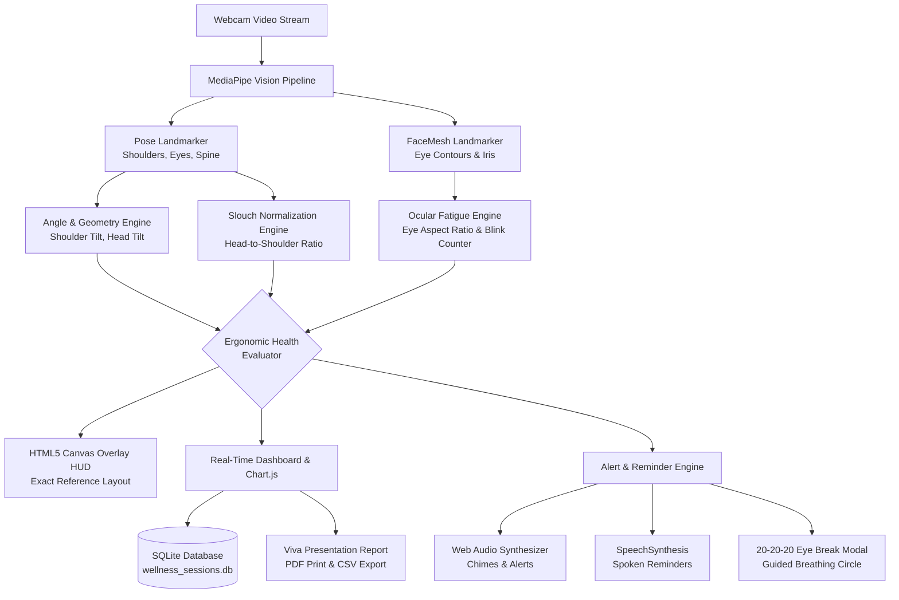

# Digital Wellness Monitor | Sitting Posture & Eye Blink AI

An AI-powered computer vision and ergonomic telemetry system designed to prevent musculoskeletal disorders (text-neck, postural kyphosis, shoulder asymmetry) and Computer Vision Syndrome (eye strain, dry eyes) during prolonged computer use.

> **Major Project Submission**  
> **Technologies:** Python 3.13, FastAPI, OpenCV, MediaPipe (Pose & FaceMesh), Web Audio API, Chart.js, HTML5 Canvas, SQLite.

---

## 🌟 Key Features

1. **Real-Time Sitting Posture Analysis**
   - **Shoulder Tilt Detection**: Measures lateral shoulder angle $\theta_s$ relative to the horizontal plane.
   - **Head & Cervical Tilt Detection**: Detects lateral neck bending $\theta_h$ to prevent cervical spine strain.
   - **Depth-Invariant Slouch Ratio**: Uses inter-shoulder distance normalization to detect spinal slouching and forward head posture regardless of camera distance.
   - **Spinal Alignment Vector**: Computes vertical alignment from the head midpoint down to the mid-clavicular/shoulder axis.
   - **One-Click Baseline Calibration**: Allows the user to calibrate their custom upright sitting posture baseline (Press `[C]`).

2. **Ocular Fatigue & Eye Blink Monitoring**
   - **Eye Aspect Ratio (EAR)**: Computes real-time eye aperture using 6 facial landmarks per eye.
   - **Dynamic Blink Counter & BPM**: Tracks blinks per minute (BPM) over a 60-second rolling window.
   - **Dry Eye & CVS Prevention**: Alerts the user when blink frequency drops below the healthy threshold (< 10 BPM).
   - **Microsleep & Drowsiness Alert**: Detects prolonged eye closure (> 2.5 seconds) to prevent exhaustion.

3. **Intelligent Ergonomic Break Alert System**
   - **20-20-20 Rule Timer**: Automatic 20-minute countdown with sound alerts and a guided 20-second visual breathing circle ("Look at an object 20 feet away for 20 seconds").
   - **Prolonged Sitting Alert**: Configurable sedentary timer (30–60 mins) prompting the user to stand up, hydrate, and stretch.
   - **Slouch Duration Alert**: Triggers visual warning banners and speech prompts if bad posture persists for > 4 continuous seconds.
   - **Multi-Modal Alerts**: Web Audio tone synthesizer, SpeechSynthesis voice prompts ("Please sit upright and align your spine"), and desktop notifications.

4. **Clinically Guided Desk Stretches**
   - Interactive modal with 6 targeted exercises:
     1. Chin Tucks (cervical spine correction)
     2. Shoulder Shrugs & Rolls (trapezius tension release)
     3. Seated Chest Opener (counteract rounded shoulders)
     4. Seated Spinal Twist (thoracic mobility)
     5. Wrist & Forearm Stretch (prevent RSI / carpal tunnel)
     6. Eye Palming Warmth (ciliary muscle relaxation)

5. **Viva-Ready Telemetry & Report Generator**
   - Live Chart.js telemetry graphing Posture Score and Blink Rate in real time.
   - Automatic Ergonomic Grading (`A+`, `A`, `B`, `C`, `D`).
   - One-click PDF Print formatting and CSV data export for academic project reports.
   - SQLite database logging session history and lifetime wellness analytics.

6. **Dual Execution Modes**
   - **Full Web Application**: High-performance, GPU-accelerated client-side processing at 30–60 FPS served by FastAPI.
   - **Standalone Desktop OpenCV Application**: Python OpenCV script (`monitor_opencv.py`) displaying the camera window and overlay HUD matching the project reference screen.

---

## 📐 Mathematical & Algorithmic Formulations

### 1. Shoulder and Head Tilt Angles
Given left shoulder $(x_{ls}, y_{ls})$ and right shoulder $(x_{rs}, y_{rs})$:
$$\Delta x = x_{rs} - x_{ls}, \quad \Delta y = y_{rs} - y_{ls}$$
$$\theta_s = \left| \arctan2(\Delta y, \Delta x) \times \frac{180}{\pi} \right|$$
Normalizing with respect to the horizontal plane gives the angular misalignment. A threshold of $\theta_s > 4.5^\circ$ flags uneven shoulders.

### 2. Depth-Invariant Slouch Ratio ($R_{slouch}$)
To prevent distance from the camera affecting slouch detection, the vertical distance between the head and shoulder midpoint is normalized by the Euclidean shoulder width:
$$\text{Head}_{\text{mid}} = \left(\frac{x_{le} + x_{re}}{2}, \frac{y_{le} + y_{re}}{2}\right), \quad \text{Shoulder}_{\text{mid}} = \left(\frac{x_{ls} + x_{rs}}{2}, \frac{y_{ls} + y_{rs}}{2}\right)$$
$$W_{shoulder} = \sqrt{(x_{rs} - x_{ls})^2 + (y_{rs} - y_{ls})^2}$$
$$R_{slouch} = \frac{y_{\text{Shoulder}_{\text{mid}}} - y_{\text{Head}_{\text{mid}}}}{W_{shoulder}}$$
When a user slouches or leans forward, their head drops vertically relative to their shoulders, reducing $R_{slouch}$. When $R_{slouch} < R_{base} \times (1 - \text{tolerance})$, a slouch event is flagged.

### 3. Eye Aspect Ratio (EAR)
For each eye, 6 landmarks ($p_1, \dots, p_6$) define the eye boundary:
$$EAR = \frac{||p_2 - p_6|| + ||p_3 - p_5||}{2 \times ||p_1 - p_4||}$$
- **Eyes Open:** $EAR \approx 0.25 - 0.35$
- **Blink Trigger:** $EAR < 0.20$ (with debounced state transition: Open $\to$ Closed $\to$ Open)

---

## 🏗️ System Architecture



---

## 📂 Project Directory Structure

```
D:\DigitalWellnessMonitor/
├── app.py                      # FastAPI Backend & REST API server
├── monitor_opencv.py           # Standalone Python OpenCV monitor (matches reference screen)
├── download_models.py          # MediaPipe task models downloader
├── requirements.txt            # Python dependencies
├── run_web.bat                 # 1-Click launcher for Web Application
├── run_desktop.bat             # 1-Click launcher for Desktop OpenCV script
├── database/
│   ├── db.py                   # SQLite database manager & session analytics
│   └── wellness_sessions.db    # SQLite session database
├── models/
│   ├── pose_landmarker_lite.task
│   └── face_landmarker.task
├── static/
│   ├── css/
│   │   └── style.css           # Modern Cyber-Glassmorphism dark theme & print styling
│   ├── js/
│   │   ├── detector.js         # MediaPipe Pose & FaceMesh vector calculations
│   │   ├── alerts.js           # Audio synthesizer, voice speech, break timers
│   │   ├── analytics.js        # Chart.js live telemetry & Viva report generator
│   │   └── app.js              # Application orchestrator & UI handlers
└── templates/
    └── index.html              # Responsive Web Application Dashboard
```

---

## 🚀 How to Run

### Method 1: Web Application (Recommended for Project Demo)
1. Double click **`run_web.bat`** (or open a terminal in `D:\DigitalWellnessMonitor` and run):
   ```cmd
   python app.py
   ```
2. Open your web browser at:
   ```
   http://localhost:8000
   ```
3. Allow webcam access when prompted by the browser.
4. Sit upright and press **`[C]`** or click **Calibrate [C]** to calibrate your personal baseline.

### Method 2: Desktop OpenCV Application
1. Double click **`run_desktop.bat`** (or run):
   ```cmd
   python monitor_opencv.py
   ```
2. Controls:
   - **`[C]`**: Calibrate upright baseline.
   - **`[R]`**: Reset session counters.
   - **`[Q]`** or **`[ESC]`**: Exit application.

---

## ⌨️ Keyboard Shortcuts (Web App)

| Key | Action |
|---|---|
| **`[C]`** | Calibrate Upright Baseline |
| **`[B]`** | Start 20-20-20 Eye Break with Guided Breathing |
| **`[Space]`** | Pause / Resume Camera |
| **`[ESC]`** | Close Active Modal Dialog |

---

## 🎓 Viva Questions & Answers for Major Project Defense

1. **Q: Why is depth invariance important in posture detection?**  
   *A: If you only measure absolute pixel distances between head and shoulders, moving closer to the camera or leaning in would artificially change the metric. By dividing the vertical head-to-shoulder displacement by the inter-shoulder Euclidean distance, the ratio becomes scale-invariant and invariant to camera distance.*

2. **Q: What is Eye Aspect Ratio (EAR) and how is a blink registered?**  
   *A: EAR is the ratio of vertical distances between upper and lower eyelids divided by twice the horizontal eye width using 6 landmarks. During open eyes, EAR remains between $0.25 - 0.35$. When eyelids close, EAR drops below $\approx 0.20$. A state-machine tracks this transition with hysteresis to prevent false double-counting.*

3. **Q: Why use client-side MediaPipe in the browser instead of sending video to a Python backend?**  
   *A: Client-side execution in JavaScript leverages local WebGL and WebAssembly hardware acceleration, delivering 30–60 FPS with zero network video latency and preserving 100% user privacy since camera frames never leave the client's device.*

4. **Q: How does the system prevent notification fatigue?**  
   *A: The system implements an alert debouncing state machine. Occasional quick adjustments or head turns do not trigger alerts; only continuous poor posture persisting beyond a configurable threshold (e.g. 4 seconds) triggers audio chimes and voice alerts.*
